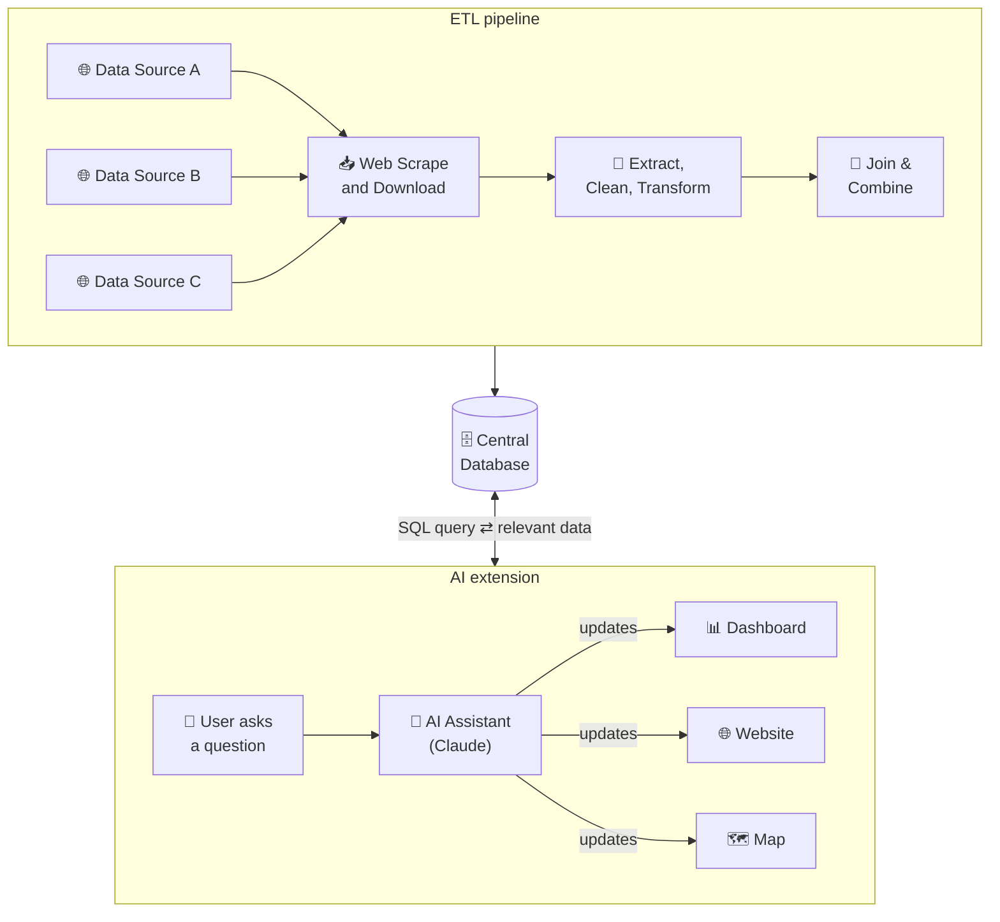

# CareConnect AI

**Healthcare prices patients can understand.** CareConnect turns CMS hospital price transparency files into plain-language, source-cited answers. Hospitals use it to attract patients who compare prices, and Perficient can implement it as a reusable data, AI and digital experience accelerator for hospitals and health systems.

This repository is a working proof of concept built in Python and Streamlit, with Claude (Anthropic) for question understanding and plain-language explanations.

---

## The business problem

A patient whose doctor orders an MRI does not know which hospital offers it, what it costs or what insurance covers. CMS requires every hospital to publish its prices, but they sit in large machine-readable files full of billing codes and different price types that patients cannot use.

So hospitals carry the cost of compliance without the benefit: price-shopping patients cannot compare them, and pricing questions go to the call center.

The variation is real. For the same knee MRI (CPT 73721), the middle half of commercial facility prices ranges from **$367 to $1,126**, a 3.1× spread ([Philips & Whaley, *Health Affairs Scholar*, 2025](https://pmc.ncbi.nlm.nih.gov/articles/PMC12097484/)).

## What CareConnect solves

| For | Value |
|---|---|
| Patients | Plain-language answers about published prices, with the source for every number. |
| Hospitals | Turns a required price file into a way to attract patients, show transparency and reduce pricing calls. |
| Perficient | A reusable accelerator to implement for hospital clients: discovery, data engineering, AI, integration and managed services. |

**How a hospital's revenue uplift is calculated:** new patients × the hospital's published negotiated rate, where new patients = price-shopping visits × booking share. Visits and booking share come from the hospital's own analytics, so no figure is shown without them.

## Proof of concept scope

- **Procedures:** knee MRI without contrast (CPT 73721), brain MRI without contrast (CPT 70551), CT abdomen and pelvis without contrast (CPT 74176). CPT stands for Current Procedural Terminology, the standard billing codes for medical procedures.
- **Plan and price type:** Blue Choice PPO negotiated outpatient facility rates. These are contracted amounts, not a patient's out-of-pocket cost.
- **Geography:** Dallas-Fort Worth hospitals.

> **Data note:** the bundled dataset is **fictional demo data** (hospital names are prefixed `DEMO`). Load verified CMS price files before presenting real rates.

---

## App tour

| Tab | What it shows |
|---|---|
| **Business case** | The business problem, what CareConnect solves, the POC scope, and what a hospital gains (with CMS and Perficient sources). |
| **Patient assistant** | Chat where a patient asks in plain language. Claude identifies the procedure; prices are retrieved from the database and shown as ranked, source-cited cards. |
| **Price explorer** | Lowest, median and highest rates, a ranked chart, a hospital × procedure heatmap and the source records. |
| **Architecture and trust** | The ETL + AI architecture diagram, safeguards, the data contract and a button that runs the acceptance tests live. |

## Architecture



**Design rule: the model never produces a price.**

1. Claude extracts the user's intent with structured output and maps it to one of the allowed CPT codes.
2. Deterministic Python runs a read-only, parameterized SQL query against the curated dataset and sorts the results.
3. Claude explains the retrieved records in plain language.
4. Every price on screen is rendered directly from the database, with its source.

If the API is unavailable or no key is set, a rules-based engine answers instead, so the app always works offline.

### Safeguards

- Prices are displayed from SQLite, never from model output.
- Structured retrieval only: no vector database, no free-form generated SQL.
- Only the supported CPT codes are answered; other procedures are declined rather than estimated.
- Every answer states that a negotiated rate is not the patient's out-of-pocket cost.
- Demo records are excluded in verified mode (`is_demo = 0`).
- No diagnosis, treatment advice or requests for personal information.
- Chat replies contain no asterisks or em dashes (enforced in code, not just the prompt).

### Data contract (12 fields)

| Field | Meaning |
|---|---|
| `record_id` | Stable unique record ID |
| `hospital_name` | Hospital identity |
| `city` | City |
| `zip_code` | ZIP code (text) |
| `procedure_code` | CPT code (text) |
| `procedure_name` | Readable procedure label |
| `plan` | `Blue Choice PPO` |
| `price` | Negotiated dollar amount (USD) |
| `source_url` | Official hospital source link |
| `source_row` | Original CSV row reference |
| `last_updated` | Published data date |
| `is_demo` | `true` only for fictional test data |

Upload a CSV with these columns from the sidebar to add verified records.

---

## Getting started

**Requirements:** Python 3.12+ (developed on 3.14).

```bash
git clone https://github.com/chanduripranav/Perficient.git
cd Perficient
python3 -m venv .venv
source .venv/bin/activate
pip install -r requirements.txt
```

### Add your Claude API key

The key is **not** included in this repository. Choose one option:

```bash
# Option 1: secrets file (recommended; already git-ignored)
cp .streamlit/secrets.toml.example .streamlit/secrets.toml
# then edit .streamlit/secrets.toml and paste your key

# Option 2: environment variable
export ANTHROPIC_API_KEY="your-key"
```

You can also paste a key into the sidebar at runtime. Without a key, the app runs in offline rules-engine mode.

### Run

```bash
streamlit run app.py
```

Open http://localhost:8501. The SQLite database (`data/careconnect.db`) is created automatically from the demo data on first run.

### Test

```bash
python -m pytest -q
```

Tests cover intent extraction, the 8 playbook acceptance tests, response formatting rules and the business-case formulas.

---

## Project structure

```
app.py                  Streamlit app (UI, tabs, chat flow)
src/ai.py               Intent extraction (rules + Claude), grounded answers, reply formatting
src/engine.py           Question → intent → parameterized lookup → answer; acceptance tests
src/data.py             12-field data contract, demo data, SQLite load and query
src/value.py            Cited figures and business-case formulas
src/diagram.py          Architecture diagram (Mermaid), served from static/
static/                 Mermaid library and generated diagram page (works offline)
assets/                 Healthcare photos (Unsplash)
data/                   Demo dataset as CSV and JSON
tests/                  pytest suite
.streamlit/             Theme config and secrets template
```

## Claude configuration

- Model: `claude-opus-5-5`, with server-side refusal fallbacks enabled.
- Intent extraction uses structured output (a Pydantic schema) at low effort for fast responses.
- Answers are streamed. Retrieved records are passed to the model as context, and the system prompt forbids inventing prices, hospitals, coverage or distances.

## Sources

- Philips & Whaley, "Commercial price variation for common imaging studies," *Health Affairs Scholar*, 2025. [PMC12097484](https://pmc.ncbi.nlm.nih.gov/articles/PMC12097484/) · doi:10.1093/haschl/qxaf092
- CMS, [Hospital price transparency](https://www.cms.gov/priorities/key-initiatives/hospital-price-transparency)
- Perficient, [Rochester Regional Health case study](https://www.perficient.com/outcomes/rochester-regional-health) (company-reported outcomes of a related engagement)
- Perficient, [AI Healthcare Concierge](https://www.perficient.com/industries/healthcare-life-sciences/ai-concierge)
- Photos: [Unsplash](https://unsplash.com/license) (free to use)

## Limitations

- The bundled price data is fictional. Real Parkland, Methodist, Baylor Scott & White and Medical City files have not yet been ingested or verified.
- Negotiated rates are not patient out-of-pocket estimates; there is no benefits, eligibility, distance or appointment integration yet.
- This is a proof of concept, not a production system.
